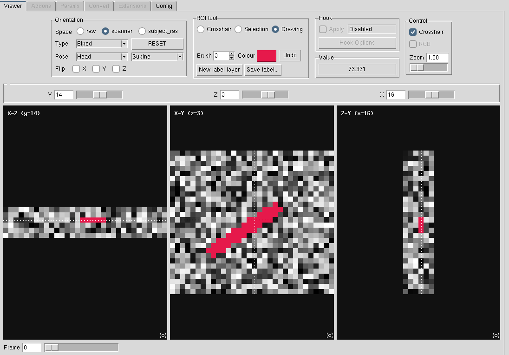

# Viewer

The default Viewer tab provides **visual QC and orientation checks** without
committing to a conversion. The Viewer application also hosts specialized
visualization panels supplied by optional extensions.

This fits the brkraw philosophy by keeping the viewer lightweight while leaning
on the same BrkRaw loaders and orientation logic used by the CLI.

## Loading data

Use the Load menu to open:

- Study folders
- Zip archives
- PvDatasets packages

The scan and reconstruction lists on the left control what is shown in the
viewport; the first scan is selected when a dataset opens. **Refresh** re-reads
the settings, reopens the current dataset and selects the same scan and
reconstruction again. The **Study Info** button opens the study parameters.

For a shared or external registry file, launch with:

`brkraw viewer --registry /path/to/registry.jsonl`

Before it reads a scan, the viewer estimates the size of the data and asks first
when it is larger than `viewer.cache.memory_limit_mb`; see
[Config](config.md#memory-notice).

## Views

The Viewer tab shows three orthogonal views of the volume: X-Z, X-Y and Z-Y.

- **Click** a view to move the X/Y/Z position (the crosshair).
- **Mouse wheel** over a view steps through the slices of that view.
- **Shift + mouse wheel** zooms, and moves the position to the voxel under the pointer.
- The **X, Y, Z** boxes and sliders set the position directly.
- **Frame** appears when the data has more than one frame, **Slicepack** when the
  scan has more than one slicepack, and **Dim 5, Dim 6, ...** for data with more
  than four dimensions.
- The camera button at the lower right of a view offers to save that view as a
  PNG file in the Convert tab's output folder (the current working folder until
  you set one), with the scan layout name plus the position and plane in the file
  name.

The views are scaled for display between the 1st and 99th percentile of the whole
frame (from at most one million evenly spaced voxels), computed once when the frame is
loaded. All three views and every slice of a frame use the same brightness range, so
moving to another slice does not change how bright a value looks. There is no
window/level control yet (see [Known limitations](#known-limitations)).

## Controls

- **Space**: raw, scanner, or subject RAS
- **Subject type / pose**: manual orientation selection, available when viewing
  subject RAS; **RESET** returns to the values taken from the scan
- **Flip**: per-axis visual flip for quick inspection
- **Crosshair**: toggle the crosshair
- **RGB**: show data whose fourth axis has three channels as colour; disabled for
  other data
- **Zoom**: scale the view from 1x to 4x
- **Value**: the value at the crosshair. For multi-frame data the button opens a
  **Timecourse** window with the voxel's time series; clicking the plot moves to
  that frame, and its capture button saves the plot as PNG.
- **Hook**: when a converter hook is selected for the scan by the rules, **Apply**
  displays the data as that hook returns it, and **Hook Options** edits the hook
  options. This is the converter hook of the scan, not a viewer extension. The options are
  shared with the Convert tab's hook options (kept once per hook): **Apply** in either tab
  changes them for both, and an open Hook Options window in the other tab shows the new
  values. If the options window cannot open (the scan has no hook, the hook cannot be
  loaded, or it has no options), a message says which.

The window opens wide enough (about 1350 px) for the five boxes of the top row, and its minimum
width is the width of that row. The window never opens larger than the usable screen area
(taskbar, menu bar and dock excluded) and is placed fully inside it; on a smaller screen the
views shrink first, and the status bar at the bottom of the window stays visible.

The status line under the views shows space, hook, zoom, RGB, crosshair and slicepack.
Tabs can be detached into their own window and re-attached from the right-click menu on
the tab title. The icon at the right of the main status bar opens the worker log.

## ROI tool box

The **ROI tool** box sits in the top row between **Orientation** and **Hook**. Its mode decides
what the mouse does on the three views; exactly one tool owns the mouse at a time.

- **Crosshair** (default): a click moves the crosshair, as before.
- **Selection**: a one-shot ROI tool. A second row, **Shape** (**Square** or **Circle**, Square by
  default), is shown only in this mode. Drag with the left button; when you release, the ROI is
  set and the mode returns to Crosshair. See [ROI timecourse](#roi-timecourse).
- **Drawing**: the left button paints and the right button erases voxels of the selected label
  layer (on macOS, where the right button is Button-2, that button erases). Drawing needs an
  editable label layer; **Drawing** is disabled until one is selected. See
  [Label painting](#label-painting).

The box also holds the paint widgets: **Brush** size, **Colour**, **Undo** and **Save label...**
(**New label layer** is in the [Layers box](#layers-box)). The **Colour** button shows the colour of the label value being painted
(label 1) on the selected label layer; click it to pick another colour with the system colour
dialog. Cancel changes nothing. Switching away from Drawing ends the stroke in progress;
switching away from Selection drops a drag in progress.

## Layers box

The **Layers** box sits in the top row, right of **Control**. It lists the layers in draw order:
the top row is drawn last (on top) and the base layer, the shown scan, is the last row, marked
"(base)". Each row shows a visibility toggle (click the box in the first column), the name and
the kind (image, label or rgb).

- Selecting an editable label layer makes it the layer the paint tool acts on, so **Drawing** is
  enabled in the ROI tool box. Selecting any other row (an image, rgb or read-only label layer, or
  the base) clears that target and **Drawing** is disabled.
- **New label layer** adds an empty editable label layer ("Label 1", "Label 2", ...) on the shown
  scan's grid and selects it. It needs a loaded scan.
- **Up** and **Down** change the draw order of the selected layer by one step. They are disabled
  for the base layer and at the ends of the list.
- **Delete** removes the selected layer; a label layer with unsaved paint edits asks first. The
  base layer cannot be deleted.
- For a selected image layer that is not the base, **Colormap** (gray, hot, red, green or blue) and
  **Min** / **Max** set how it is drawn. **Apply** (or Enter in an entry) applies them; empty
  **Min** and **Max** return to the automatic range. A **Min** that is not below **Max**, or text
  that is not a number, shows a message in the box and changes nothing. The controls are disabled
  for label layers, rgb layers and the base layer.

The list follows layers added or removed in the GUI, through the
[Python layers API](../dev/hooks.md) (provisional) and on a scan reload.

## ROI timecourse

The **Selection** mode of the ROI tool box draws a temporary region of interest on one view and
plots its mean timecourse.

1. Choose **Selection**, then **Square** or **Circle**. While Selection is on, clicking a view
   does not move the crosshair.
2. Press in a view and drag: the shape is drawn as you move. A square spans the two corners
   of the drag; a circle has the drag as its diameter.
3. Release the button: the ROI is set on the slice shown in that view, the mode returns to
   Crosshair, and the Timecourse
   window (open it with the **Value** button) shows the mean of the voxels inside the ROI for
   each frame. The title gives the shape and the voxel count.
4. **Esc** (with the pointer or focus on a view) removes the ROI; the plot returns to the voxel
   timecourse. The ROI stays shown until the next selection or Esc. In Crosshair mode, clicking
   works as before.

Limits: one ROI at a time, in 2D on one slice of one view, never saved. It is cleared when you
change the slice on its axis (scrolling, the sliders, a click in another view), the scan,
reconstruction, hook or hook options, slicepack or flip. Changing the frame does not clear it.
A drag that is only a click sets nothing. Values that are not finite are left out of the mean.
Python access is described under [Viewer hooks](../dev/hooks.md) (provisional).

## Label painting

The **Drawing** mode of the ROI tool box paints voxels of a label layer in the three views.
**Drawing** and **Brush** are enabled only when an editable label layer is selected;
**Undo** and **Save** follow their own state; **New label layer** (in the Layers box) is enabled once a scan is loaded.

1. Press **New label layer** in the Layers box. It adds an empty label layer ("Label 1", "Label 2", ...) on the
   shown scan's grid and selects it. It needs a loaded scan.
2. Choose **Drawing** (**Crosshair** is the default). While Drawing is on, clicking a view
   does not move the crosshair, and the ROI selection is off (one tool at a time; choosing
   **Selection** switches drawing off).
3. Set the **Brush** size (1 to 99): it is the diameter in voxels of a disc, in the slice shown
   in that view. Press in a view and drag: the left button writes label 1 and the right button writes 0.
   Points outside the volume are ignored.
4. Release the button: the stroke is one undo step.

Undo and cancel:

- **Undo** (or **Ctrl+Z** with focus on a view; a press in a view gives it focus) reverts the last
  finished stroke. The undo history is kept in memory up to 64 MiB; the oldest steps drop first.
- **Esc** (with focus on a view) cancels the stroke in progress and restores the voxels it changed.
  It is not an undo step.

Saving: **Save label...** asks for a file name and writes the layer as `.nii.gz` (the extension is
added when missing) with the layer's affine; the data type is uint8, or uint16 when a label is
above 255. The layer stays editable. A painted layer lives in memory only until you save it; there is
no autosave. When a layer with unsaved edits is removed through the controller, a confirmation
asks first ("... has unsaved edits. Remove it anyway?"); Delete in the Layers box
asks the same question before it removes a layer with unsaved edits.

## Registry

Open the registry window from the toolbar to browse registered datasets, add or
remove entries, and load directly into the viewer. Use **Current session** in the
`+` menu to add whatever is currently loaded; it is disabled until a dataset is
open. The `+` menu can also add a study folder or an archive file.

## Known limitations

- One image volume is shown at a time. The layer core (grids, resampling, layer
  composition, ROI statistics) exists in `brkraw_viewer.core`. The Viewer tab has the
  Layers box, the temporary 2D ROI timecourse above and [Label painting](#label-painting).
  A layer carries a single label value (painting always uses label id 1), there is no
  underlay colormap yet, and a fast diagonal drag on an oblique layer grid can leave gaps (no
  gap filling there).
- Brightness is one range per frame as described under [Views](#views); there is no
  window/level control yet.
- Extensions cannot draw on the Viewer tab; they add a panel in the Extensions tab.
